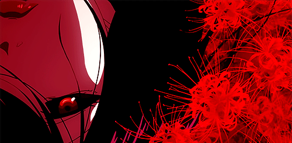

<!-- GIF BANNER -->

  

<!-- USERNAME: BLACK BANNER -->

  

<!-- ANIMATED TEXT -->

  

---

<!-- ABOUT ME -->

  

- Exploring Linux, programming and everything in between.
- Learning Python, Java and web development.
- Interested in music, technology and dark aesthetics.
- Building things at my own pace.

 

<!-- TECH & TOOLS -->

  

**Systems**

  
  

**Languages**

  
  

**Tools**

  
  
  

<!-- VS CODE AND CHATGPT: KEEP ORIGINAL ICONS -->

  
  
  
  

---

  <i>Even the darkest roses bloom.</i>

